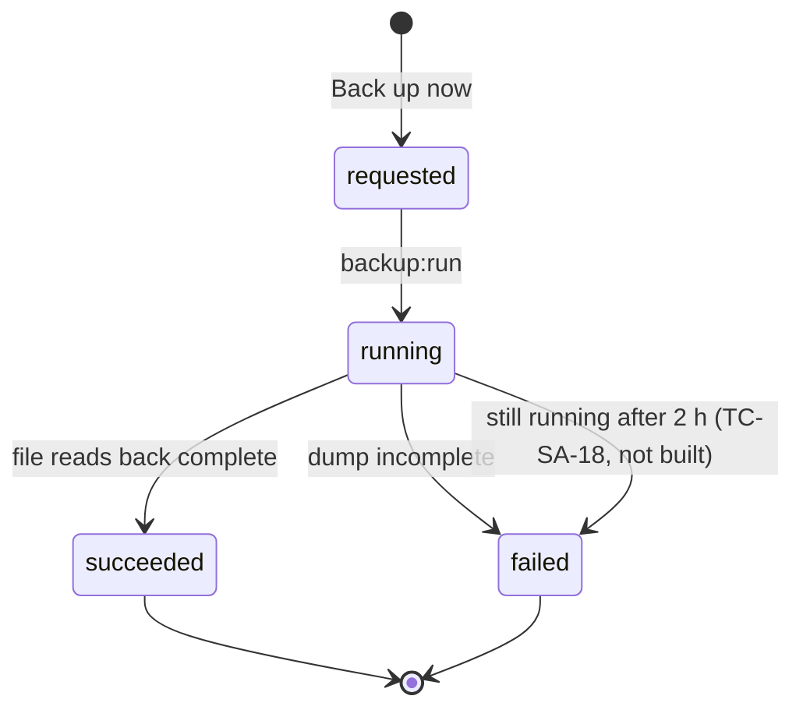

# Wave 1 test analysis

| | |
|---|---|
| **Date** | 2026-10-28 |
| **Code under test** | `ae86042` on `docs/qa-test-cases` |
| **Method** | The `test-case-designer` skill. Its two review gates (confirming the technique stack, then approving this analysis) were passed under the owner's delegation of 2026-10-28 ("full permission and full decisions"). The cases are written in the catalog's own format (`docs/test-cases/README.md`), not the skill's 10-column table, because the owner chose to add them to the existing P-files. |
| **Status** | Written, not run. No case here has been executed. |

## 1. Module overview

Wave 1 covers the scenarios of the QA plan's critical-risk modules whose expected result is not today's behavior: regressions (`REG`, `REG?`), committed fixes not yet run (`FIX?`) and requirements not built (`NB`). The modules are: route access, web security, the institution lifecycle (purge), backups, monitoring, scheduled jobs, chairperson assignment, quiz taking and authoring, question import, the gradebook, finalization, override requests and sign-off. The business objective is that grades, accounts and backups cannot be silently lost or changed, and that quiz attempts are scored fairly.

## 2. Test scope

**In scope:** the 35 Wave 1 scenarios of `coverage-matrix.md` (Part C), and the rewrite of the three stale catalog cases TC-CRS-03, TC-DEAN-04 and TC-DEAN-05 (register PLN-03).

**Out of scope for this wave:** scenarios whose expected result is today's behavior (`READY-VCI`, `READY-IBR`), which are waves 2 and 3; exploratory charters and checks (wave 4); the other catalog tidy-ups (the missing fields of the older system-administrator cases, `p2-chairperson.md`, the 12 browser tests no case names); updating the Playwright specs to the rewritten cases.

## 3. Risk assessment

| Area | Risk | Reason |
|---|---|---|
| Purge (TC-SA-13, 14) | 🔴 High | Irreversible deletion of accounts and files; privacy (PLN-09) |
| Backups (TC-SA-15 to 18) | 🔴 High | The only recovery path; a stuck row stops every later backup |
| Scheduled jobs and monitoring (TC-SA-19 to 22) | 🔴 High | All notifications and backups depend on the jobs running |
| Quiz attempts (TC-QUIZ-04 to 07, 10) | 🔴 High | Scores of record; concurrency |
| Quiz authoring validation (TC-QUIZ-08, 09, 11, 12) | 🔴 High | No server validation exists today |
| Grade chain: weights, sign-off, overrides (TC-GBK-06, 07, TC-DEAN-04, 05, 12, 13) | 🔴 High | Final grades and who may change them |
| Chairperson assignment (TC-CRS-03 to 05) | 🟡 Medium | Routes the override chain; covered by new tests |
| Dean assignment screen (TC-CRS-06) | 🟡 Medium | Not built; deans come only from the seed and the SIS |
| Permissions in menus and discussions (TC-DEAN-14, TC-IAA-07) | 🟡 Medium | The server already refuses; the menu only misleads |
| Web security (TC-SA-23, 24) | 🟡 Medium | Not built; matters most in production |
| Quiz password and lockdown, import sniffing (TC-QUIZ-13, 14) | 🟢 Low | Not built; settings exist but do nothing |

## 4. Coverage targets

P1: 100% of the wave's P1 scenarios written (22 of 22). P2: 100% written (12). P3: written where they fit a case (3). Every case states the scenario it covers, so the traceability below is complete.

## 5. Scenario analysis (layer 1)

Each case has a main path and its alternates. The main paths that matter most, marked as smoke for this wave: TC-QUIZ-04 (one attempt across tabs), TC-SA-15 (a backup counts only once proven), TC-SA-13 (purge removes what it should).

## 6. Equivalence and boundary analysis (layer 2)

| Field | Valid classes | Invalid classes | Boundary points | Case |
|---|---|---|---|---|
| Quiz attempt limit | integers ≥ 1; blank = unlimited | 0, negatives, decimals, text | −1, 0, 1, 2; a large value (99) | TC-QUIZ-08 |
| Quiz duration | integers ≥ 1; blank = no limit | 0, negatives, text | −5, 0, 1 | TC-QUIZ-12 |
| Question points | 0 to the upper limit | negatives, above the limit | −1, 0, 1; max−1, max, max+1 once a limit is decided (none is decided: the case records the code's) | TC-QUIZ-12 |
| Category weights total | exactly 100 | below or above 100 | 99.99, 100, 100.01; 90, 110 | TC-GBK-06 |
| Stuck backup age | under 2 hours | 2 hours or more | just under, at and just over 2 hours | TC-SA-18 |
| Job silence | within the job's gap | past the gap | 15 min (`backup:run`, `exports:run`), 45 min (`parents:notify`), 26 h (daily jobs) | TC-SA-19, 22 |

## 7. Decision table analysis (layer 3)

**Who may sign off or reopen a section's sign-off** (`GradeSignoffService::mayDecide`; TC-DEAN-05, 13, TC-GBK-07):

| Condition | 1 | 2 | 3 | 4 |
|---|---|---|---|---|
| Department has a dean holding `grades.signoff` | Y | Y | N | N |
| Actor is that dean | Y | N | – | – |
| Actor is an administrator of the institution holding `grades.signoff` | – | Y | Y | N |
| **May sign off or reopen** | **Yes** | **No** | **Yes** (own section excluded for sign-off) | **No** |
| Reopen needs a reason | Y | – | Y | – |
| Reopen needs the password | N | – | N | – |

**Who decides an override request** (`GradeAuthority`; TC-DEAN-04, 12): an eligible dean if one holds `grades.approve`, else the institution's administrators; never the requester. A request is refused while the grades are finalized (decision AMB-ASG-05).

## 8. Orthogonal analysis (layer 4)

Not used. No case in this wave has three or more independent parameters whose combinations matter.

## 9. State transition analysis (layer 5)



```mermaid
stateDiagram-v2
    [*] --> InProgress : Take Quiz (second tab resumes, TC-QUIZ-04)
    InProgress --> InProgress : save answer (last save wins)
    InProgress --> Submitted : submit (once only, TC-QUIZ-05)
    InProgress --> Cancelled : staff cancel (not built; does not count, TC-QUIZ-10)
    Submitted --> [*]
```

Chairperson assignment: none → active (assign) → revoked (replace, with confirmation; or remove). Only one `active` per sub-department (TC-CRS-03 to 05).

## 10. Error guessing

Defect-prone areas, highest risk first: concurrent writes (two tabs, two administrators, a chair and a requester); partial failure (half-written backup, a file that will not delete, a failed off-site copy); a value the browser never sends but the server accepts (attempt limit 0, empty question, File Upload type); wording that names the wrong role ("Signed off by the dean"); a monitor that records an attempt as a success (`parents:notify` heartbeat); a guard in the page but not the server (discussion moderation).

## 11. Requirement traceability

| Scenario | Decision or requirement | Test case |
|---|---|---|
| PS-QUZ-05 | 15.1 | TC-QUIZ-04 |
| PS-QUZ-06 | 15.2 | TC-QUIZ-05 |
| PS-QUZ-07 | 9.1 | TC-QUIZ-06 |
| PS-QUZ-19 | AMB-ASM-03 | TC-QUIZ-07 |
| PS-QUZ-14 | AMB-ASM-09 | TC-QUIZ-08 |
| PS-QUZ-15 | AMB-ASM-08, MISS-QZ-03 | TC-QUIZ-09 |
| PS-QUZ-16 | AMB-ASM-06 | TC-QUIZ-10 |
| PS-ASM-03 | AMB-ASM-02 | TC-QUIZ-11 |
| PS-ASM-04 | MISS-ASM-01 | TC-QUIZ-12 |
| PS-ASM-12 | AMB-DB-02 | TC-QUIZ-13 |
| PS-QBK-09 | MISS-ASM-02 | TC-QUIZ-14 |
| PS-GBK-04 | AMB-ASG-02 | TC-GBK-06 |
| PS-FIN-04 | AMB-ASG-04 | TC-GBK-07, TC-DEAN-05 |
| PS-OVR-11 | AMB-ASG-05 | TC-DEAN-12 |
| PS-SGN-08 | AMB-ASG-04 | TC-DEAN-13 |
| PS-RBA-09 | AMB-AUTH-08 | TC-DEAN-14 |
| PS-RBA-12 | D6 | TC-IAA-07 |
| PS-CHR-06 | 16.0 | TC-CRS-04 |
| PS-CHR-07 | AMB-INST-07 | TC-CRS-05 |
| PS-CHR-12 | MISS-INST-01 | TC-CRS-06 |
| PS-INS-04 | 10.1, 10.2 | TC-SA-13, TC-SA-14 |
| PS-INS-05 | 10.3 | TC-SA-13 |
| PS-INS-06 | 10.4, 10.5 | TC-SA-13, TC-SA-14 |
| PS-BAK-02 | 11.1 | TC-SA-15 |
| PS-BAK-03 | 11.2 | TC-SA-16 |
| PS-BAK-04 | 11.4 | TC-SA-17 |
| PS-BAK-05 | U3 | TC-SA-17 |
| PS-BAK-06 | MISS-OPS-03 | TC-SA-18 |
| PS-MON-04 | 6.2, U2, D11 | TC-SA-19 |
| PS-MON-05 | U2 | TC-SA-20 |
| PS-JOB-02 | D5, 6.4 | TC-SA-21 |
| PS-JOB-05 | 6.4 | TC-SA-21 |
| PS-JOB-06 | DOC-24 | TC-SA-22 |
| PS-SEC-08 | MISS-AUTH-02 | TC-SA-23 |
| PS-SEC-09 | MISS-AUTH-03 | TC-SA-24 |
| PS-CHR-01, PS-CHR-08 (rewrite) | 16.0, PLN-03 | TC-CRS-03 |
| PS-OVR-04 (rewrite) | 1.1, 1.3, PLN-03 | TC-DEAN-04 |
| PS-SGN-03, PS-SGN-04 (rewrite) | AMB-ASG-04, PLN-03 | TC-DEAN-05 |

## 12. Found while writing

- `ParentsNotify::run` records its heartbeat whatever exit code the work returns, so a failed run can count as a successful one (TC-SA-22, step 2; suspected).
- A blank (null) attempt limit becomes 1, not unlimited (TC-QUIZ-08).
- A cancelled attempt counts against the limit (TC-QUIZ-10; seen in the code).
- `DeanAssignmentService` exists but no screen calls it (TC-CRS-06).
- The Playwright tests for TC-CRS-03 and TC-DEAN-05 still follow the old cases and must be updated to the rewritten steps.
