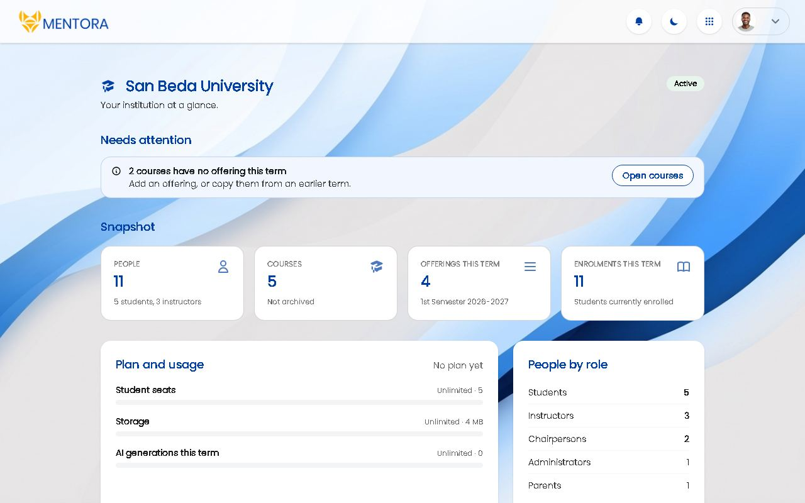
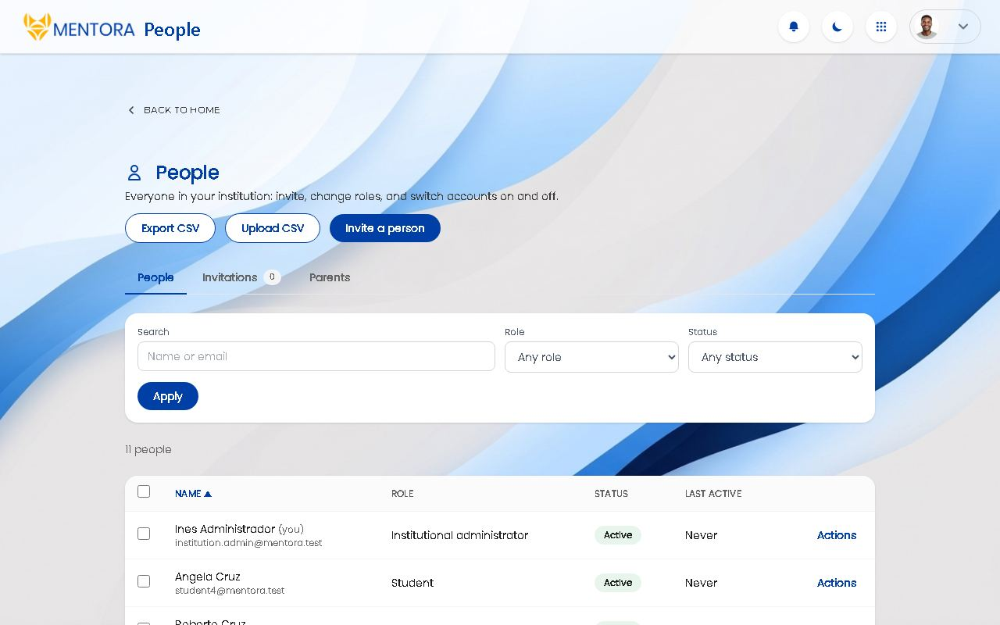
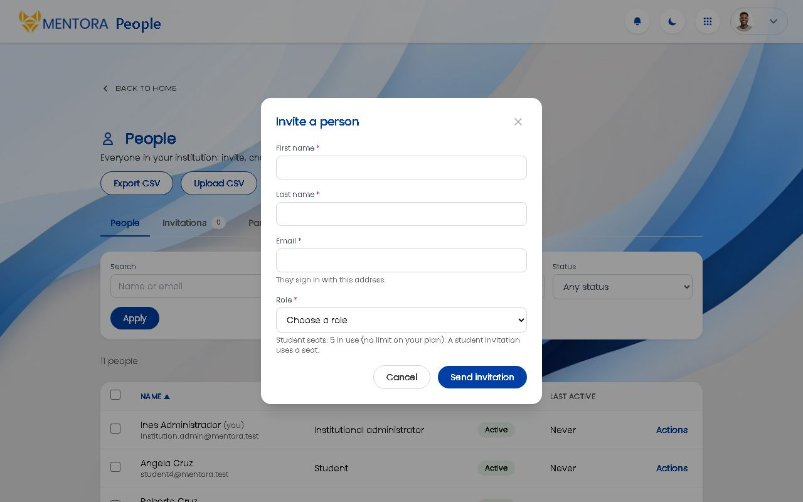
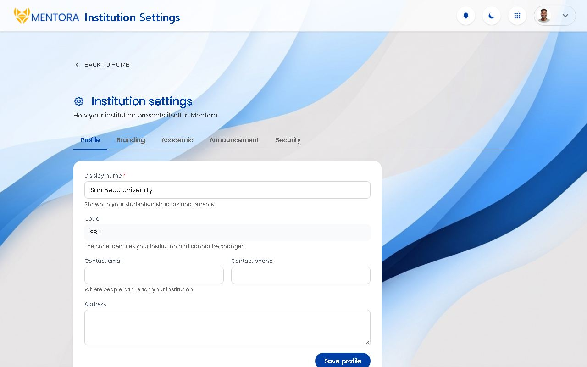
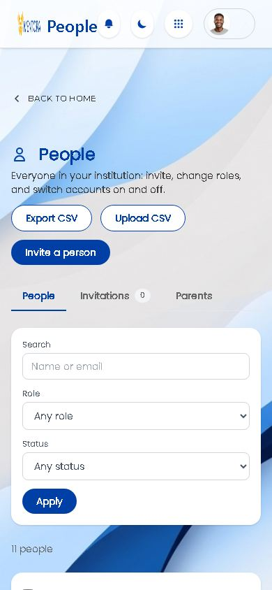

# UI guide

How a Mentora screen is built, so a new one looks and behaves like the ones
that exist. It was written from the institutional administrator's area, which
was built from the shared components in `app/Views/components/`; the student
and instructor areas use the same shell and tokens.

Two ways to see the pieces working:

- `/ui-kit`, a gallery of every component in every tone (signed-in people; it is
  not routed in production).
- The institution area itself: Home, People, Offerings, Reports, Settings.

## 1. The rules, in one list

1. Use `layouts/app` and the shared components. A new pattern needs a reason in the pull request.
2. Colours come from tokens (`bg-brand`, `text-brand`, `bg-brand-tint`), never a hex for the brand.
3. Every list and every form has all four states designed: loading, empty, error, filled.
4. Read-only and locked are visible before the click; the server refuses anyway.
5. Every action answers within a second: a toast, or the error beside the field, with what was typed kept.
6. Nothing irreversible without a confirm that says the consequence.
7. Everything works with the keyboard alone, and at 360 px as at 1440 px.
8. Words are plain, short, sentence case, in the person's vocabulary.

## 2. The design language

| Thing | Rule | Where |
|---|---|---|
| Shell | `layouts/app`: glass header, Apps menu, background image. The header names the page beside the logo only when the page has no `<h1>` of its own, so it is said once | `app/Views/layouts/` |
| Fonts | Body Poppins (`font-sans`); numbers and card titles Parkinsans (`font-display`); small caps labels Montserrat (`font-heading`) | `resources/css/app.css` |
| Brand | `bg-brand` `#0040A6`, `bg-brand-dark` `#002068`, `bg-brand-tint` `#F2F7FF`, `bg-accent` `#2E7D4F`. An institution may override them (Settings, Branding), so use the tokens, not the hex | `@theme` in `app.css`, `shared/brand-tokens.js` |
| Text | Headings `text-brand`; strong `#1A1C1E`; body `#3D3D3D`; muted `#646464` | components |
| Status tones | success `#2B7549` on `#E8F5EC`; warning `#946200` on `#FFF1D6`; danger `#C33939` on `#FDEDEC`; info `brand-dark` on `#E0E5F2`; neutral gray | `status-badge`, `alert` |
| Surfaces | Dashboard tiles may be glass (`bg-white/20 backdrop-blur-xl`). Work surfaces (lists, forms, tables) are solid white `rounded-2xl` with `shadow-sm` | pages |
| Buttons | Primary: `rounded-full bg-brand px-5 py-2 text-sm font-semibold text-white hover:bg-brand-dark`. Secondary: same shape, white with a brand border. Destructive: `#C33939`. One primary per view | pages |
| Inputs | `rounded-lg border-gray-300 px-3 py-2 text-sm`, a brand focus ring, the label above in `text-xs font-medium text-gray-600` | `form-field` |
| Icons | `icon('name', 'h-4 w-4')` from the registry only; add a missing one to `app/Helpers/icon_helper.php` | helper |
| Feedback | A toast at the bottom right; the progress bar on top while a page loads | `shared/toast.js`, `shared/spa/` |
| Motion | 150 to 220 ms, ease-out; stops under `prefers-reduced-motion` | `app.css` |
| Focus | A visible brand ring on every interactive element: `focus-visible:ring-2 focus-visible:ring-brand/50` | everywhere |

Status never relies on colour alone: a badge or alert always carries a word or
an icon as well, and a screen-reader-only word where the icon is the signal.

## 3. The components

Each is a view partial with its parameters documented at the top of the file.
Call it with `view('components/<name>', [...], ['saveData' => false])`; the last
argument stops its data leaking into the next view.

| Component | For | Main parameters |
|---|---|---|
| `page-head` | The start of every management page: back link, icon and title (the one `<h1>`), description, actions | `title`, `icon`, `description`, `backUrl`, `backLabel`, `actions` |
| `toolbar` | The filter bar above a list; filters live in the address so a view can be shared | `action`, `fields` (search, select, date), `filtered`, `clearUrl` |
| `data-table` | The one list table: sortable headers, row action menu, optional select column and bulk bar; stacks into cards below `md` | `caption`, `columns`, `rows`, `sort`, `dir`, `sortUrl`, `selectable`, `bulk`, empty-state text |
| `pagination` | "Page 2 of 7", Previous and Next, the filters kept in each link | `page`, `pages`, `baseUrl`, `query`, `total` |
| `dialog` | A modal over the page for a short form | `id`, `title`, `body`, `footer`, `size` |
| `confirm` | "Are you sure?" that says what will happen; may need a name typed | `id`, `title`, `text`, `action`, `confirmLabel`, `tone`, `typeToConfirm`, `ajax` |
| `form-field` | Label, control, help and error tied together | `name`, `label`, `type`, `value`, `options`, `help`, `error`, `required`, `maxlength` |
| `alert` | An inline message on a page | `tone`, `text`, `title` |
| `tabs` | Sub-views of one page, each its own address | `tabs` (label, href, active, count) |
| `stepper` | Where you are in a multi-step flow | `steps`, `current` |
| `lock-note` | Why something cannot be changed here | `kind` (sis, read_only, closed), `text` |
| `usage-bar` | A value against a limit, with the 90% and 100% tones | `label`, `used`, `limit`, `unitLabel` |
| `metric-card` | A summary number | `label`, `value`, `detail`, `icon`, `tone` |
| `status-badge` | One pill for every status | `label`, `tone`, `icon` |
| `empty-state` | "Nothing here yet" with the first action | `title`, `text`, `icon` |
| `skeleton` | The loading shape of a list or card | `rows`, `label` |

JavaScript is a small module per behaviour in `resources/js/shared/`:
`dialog.js` (open, focus trap, Escape, form posting), `toast.js`,
`data-table.js` and `selection.js` (bulk bar). They bind through `data-*`
attributes, so a page without scripts still works as plain forms and links.

Two naming rules that have bitten before, because view data is shared between
views: do not name page data like a component parameter (`unit`, `error`,
`value`, `type`, `options`, `detail`), and pass everything a component depends
on explicitly.

## 4. Page patterns

### A list

`page-head` → `toolbar` → a result line ("11 people", `aria-live`) →
`data-table` → `pagination`. Search runs on Enter or Apply; sort and filter
live in the address; 25 rows a page, paged on the server. The empty state
differs when nothing matches ("No people match these filters") from when
nothing exists yet ("No people yet", with the first action).

### A short form in a dialog

The page holds the dialog with `form[data-dialog-form]`. `shared/dialog.js`
posts it and the server answers:

| Status | Body | The page does |
|---|---|---|
| 200 | `{ message, redirect? }` | toasts the message and goes to `redirect` (or reloads) |
| 422 | `{ errors: { field: "text" }, message? }` | shows each error beside its field, keeps what was typed |
| 403 | `{ error: "reauth_required" }` | opens the password dialog, then repeats the action |

On the server this is the `AnswersDialogForms` trait (`run($change, $success,
$back)`): a `StructureException` carries the message and the field errors, so
the same code answers a dialog, a plain page form and a script. Without
JavaScript the form posts normally and the page redirects with a flash message.

### A dangerous action

Use `confirm`, which says what will happen in plain words and names the thing
("Deactivate Ann Lee?"). Type-the-name only for the irreversible ones. Put the
`reauth` filter on the route; a page that may ask for the password passes
`'reauthDialog' => true` so the dialog is there. The password is asked in a
dialog over the page and the action resumes; nothing typed is lost.

The system administrator's pages work the same way: a form with `data-dialog-form` is posted by the script, and the `ajaxredirect` route filter hands a redirect back as JSON (`{ redirect }`) so the message set for the next page is still there when the script goes to it. Without the script the form posts normally and the confirm page opens instead.

### A multi-step job

A page with a `stepper` (Upload → Preview → Apply), not a dialog. A preview
changes nothing and says "Nothing has been saved yet" until the last step.

### Settings with tabs

`tabs` are real links (each tab its own address). Saved changes are
audit-logged with the old and new values.

### Read only and locked

- A read-only institution shows the banner, hides or disables what writes, and
  says why with `lock-note`. The route group `readonly` refuses non-GET on the
  server even if a script sends one.
- Something the SIS supplies shows `lock-note kind=sis` and its fields are
  disabled; `SisOwnership` decides, and the server refuses a write.
- A closed term's offerings say so, and writes are refused.

## 5. Interaction rules

1. **Four states, always:** loading (a skeleton, never a blank page), empty (what this is and the first action), error (what happened, that nothing was lost, Try again), filled.
2. **Locked is visible before the click**, with the reason; the server still refuses.
3. **Feedback within a second:** a toast naming what changed ("Ann Lee was invited"); errors next to the field, values kept.
4. **No irreversible action without a confirm** that states the consequence.
5. **Bulk actions** appear only when rows are ticked, say how many, and report "8 done, 2 skipped" with the reasons.
6. **Words:** plain, short, sentence case, the person's vocabulary (person, course, term), no internal names or ids. Dates as "12 Oct 2026"; counts with units.
7. **Keyboard and screen reader:** everything reachable by Tab in reading order; dialogs trap focus and give it back; tables have captions; live regions announce results; contrast at least WCAG AA; targets at least 40 px.
8. **Responsive:** 360 px to wide desktop. Tables stack into cards; the filter bar wraps; dialogs fill the width on a small screen.
9. **Speed:** lists paginate on the server; no layout shift when data arrives.
10. **Consistency over novelty.**

## 6. Server rules a screen relies on

- **Scope:** the institution is decided on the server from the signed-in person (`InstitutionScope`), never from an id in the address; a foreign id answers 404.
- **Permissions:** a route carries `permission:<name>`; the page offers only what the person may do.
- **Writes** sit in the `readonly` group; reading and export stay open.
- **Audit:** every create, edit, deactivation, role change, enrolment change, settings change, import, export and view-as writes an entry (never a password: keys that look secret are redacted).
- **Nothing with history is hard-deleted:** it is archived or made inactive.

## 7. Acceptance list for a screen

A pull request that adds or changes a screen is not done until:

- [ ] It uses `layouts/app` and only the shared components and tokens; no one-off colours, radii or button shapes.
- [ ] Loading, empty, error and filled states exist; read-only and SIS-locked where they apply. A screenshot of each is in the pull request.
- [ ] It works at 360, 768 and 1440 px with no sideways scrolling of the page.
- [ ] A keyboard-only walk-through passes, and the page is in the accessibility check of `tests/e2e/institutional-admin.spec.js` (axe reports nothing serious).
- [ ] Every action gives feedback; every destructive action confirms; there are no dead buttons.
- [ ] The words were read aloud once by someone who is not the author.
- [ ] A foreign id, a person without the permission and a read-only institution are each tested.
- [ ] The behaviour is in a feature test and, if it is a journey, in the end-to-end spec and `docs/test-cases/`.

## 8. Known gaps

- The system administrator's area is on the shared shell (header, Apps menu, page heads, alerts) but its lists, forms, onboarding (a `stepper`) and password confirmation use the shared components. A few forms of the institution's own pages (the subscription, the flag overrides, the integration connection and the user's page) still use plain labels with the shared button and input styles.
- Dark mode: the header button exists and does nothing yet.
- A few literal greens (`#2E7D4F`) remain where a token would be better (`bg-accent`); new code should use the token.
